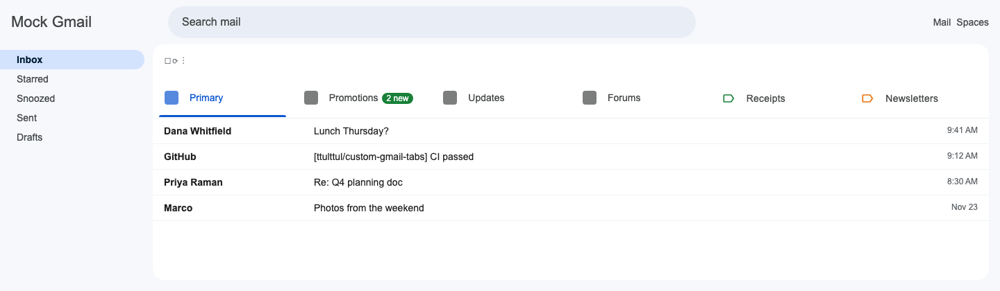
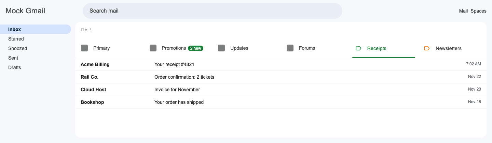
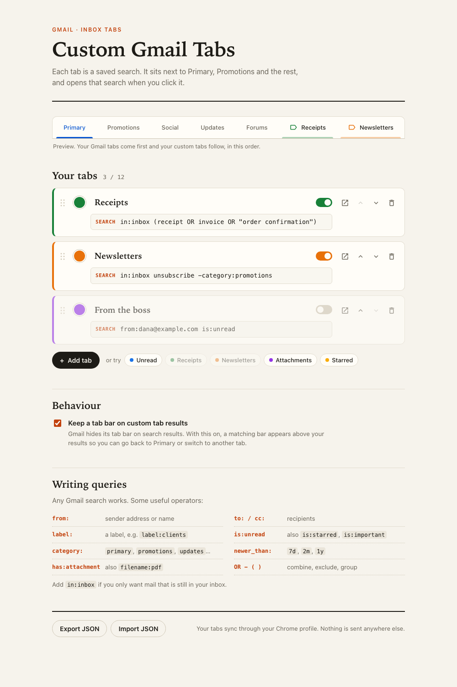

# Custom Gmail Tabs

A Chrome (Manifest V3) extension that adds your own tabs to Gmail's inbox tab bar, next to
**Primary**, **Promotions**, **Social**, **Updates** and **Forums**. Each tab is a Gmail search
query, and clicking the tab runs that search.



When a custom tab is open, Gmail would normally hide its tab bar because the view is a search.
The extension shows a matching bar above the results instead, so you can switch to another custom
tab or go back to Primary in one click. You can turn this off in the extension's options.



## Install (unpacked)

1. Clone this repo.
2. Open `chrome://extensions` and turn on **Developer mode**.
3. Click **Load unpacked** and choose the repo folder (the one containing `manifest.json`).
4. Open the extension's **Options** to add tabs. You can also click the toolbar icon and choose
   **Manage**.
5. Reload Gmail.

This also works in other Chromium browsers (Edge, Brave, Arc).

## Setting up tabs



- **Name**: the label shown on the tab.
- **Search**: any Gmail query, for example `from:boss@example.com is:unread`,
  `label:clients newer_than:7d`, or `in:inbox (receipt OR invoice)`.
- **Colour**: used for the tab's icon and its selected underline.
- **Toggle**: hides a tab without deleting it.
- **Reorder**: drag a row by its handle or use the arrows. Custom tabs always appear after
  Gmail's own tabs.
- **Try** (↗) opens the search in Gmail so you can check the results.
- **Presets**: one-click starting points (Unread, Receipts, Newsletters, Attachments, Starred).
- **Export / Import JSON**: back up your tabs or move them to another profile.

Tabs are saved in `chrome.storage.sync`, so they follow your Chrome profile across machines.
Changes show up in open Gmail tabs right away, with no reload. You can have up to 12 tabs.

The toolbar popup lists your tabs too. Clicking one opens it in the current Gmail tab, or in a
new tab if you're not on Gmail.

## How it works

- `src/content/content.js` runs on `mail.google.com`. It finds Gmail's category tab bar by ARIA
  role (`[role="main"] [role="tablist"]`), not by class name, since Gmail's class names are
  obfuscated and change often. It appends one cell per custom tab after the last native tab.
- Clicking a custom tab sets `location.hash` to `#search/<query>`, the same URL Gmail uses for
  searches, so the browser's back and forward buttons behave normally.
- A `MutationObserver` re-adds the tabs whenever Gmail redraws its bar. Rendering happens in a
  microtask, before the browser paints, so the tabs don't flicker.
- On a custom tab's results, Gmail hides its tab bar but keeps it in the page. The script copies
  that bar, with its real icons, "N new" badges and previews, and puts the copy where the bar sits
  on the inbox. It clears Gmail's selected styling from the copy and selects your tab instead.
  Picking a category there goes back to `#inbox` and clicks the real Gmail tab.
- To keep the layout the same as the inbox, the script hides Gmail's search-only rows above the
  results (Mail / Conversations / Spaces, filter chips) and empties the search box while it shows
  the tab's query. It finds those rows by comparison: they are rows above the results that weren't
  visible on the inbox. Anything you type into the search box is left alone.
- If Gmail's fixed-width tab cells would overflow the panel, the bar switches to equal-width
  columns.
- The only permission is `storage`. The extension doesn't read message contents and makes no
  network requests.

### Caveats

- The extension depends on Gmail's DOM structure: the ARIA roles on the tab bar and the
  `#search/` URL scheme. Both have been stable for years, but a Gmail redesign could break the
  injection. If tabs stop appearing, please open an issue. The toolbar popup will still work,
  because it only sets the URL.
- The tests run against a mock of Gmail's structure (`test/fixture/gmail-mock.html`), not live
  Gmail.
- Custom tabs show no unread count.

## Development

No dependencies are needed beyond Node 20+ and Chrome.

```sh
npm test            # unit tests + headless-Chrome tests against the mock Gmail DOM
npm run check       # manifest/file/syntax checks
npm run screenshots # regenerate docs/screenshots/*.png
npm run icons       # regenerate icons/*.png
npm run zip         # build dist/custom-gmail-tabs.zip for the Chrome Web Store
```

Set `CHROME_PATH` if Chrome isn't installed in a standard location.

```
manifest.json
src/shared/core.js       query/hash helpers, sanitising, storage (shared + unit-tested)
src/content/             injected into Gmail
src/options/             options page
src/popup/               toolbar popup
test/core.test.js        unit tests
test/e2e.test.js         runs test/fixture/gmail-mock.html in headless Chrome
```

## License

MIT
